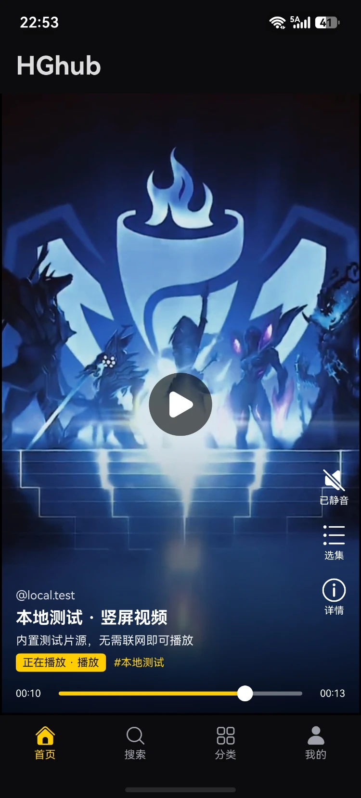
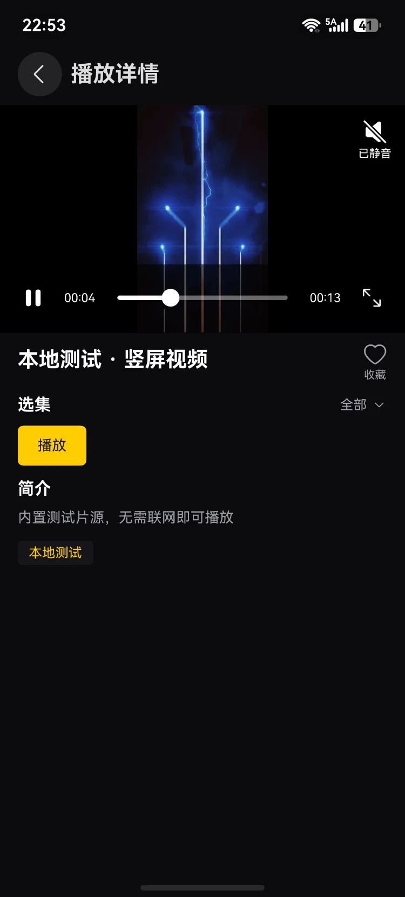
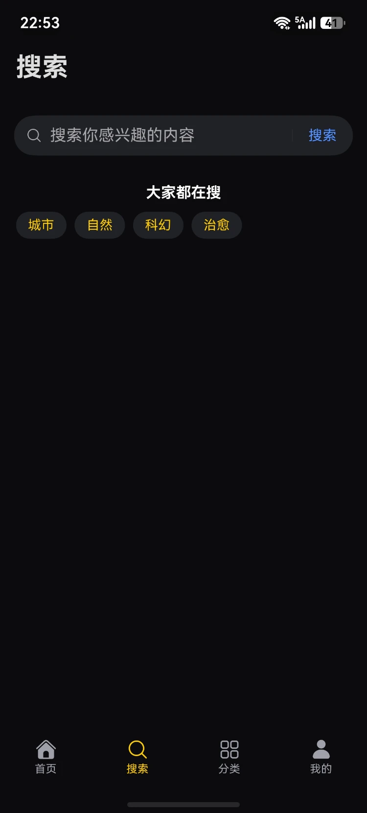
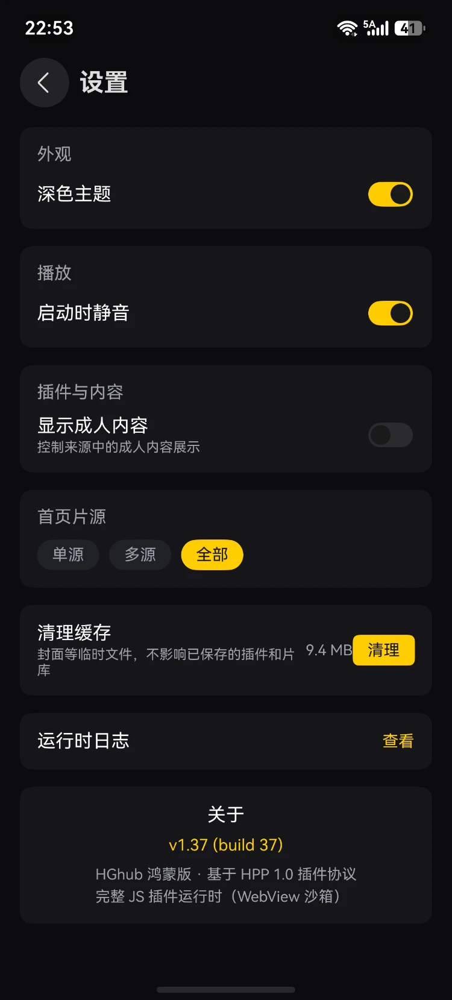

# HGhub 鸿蒙版（HarmonyOS）

> **重要声明：本项目是 [Minireel/HGhub](https://github.com/Minireel/HGhub) 的衍生分支 / HarmonyOS 移植版。**
> 实现过程中参考了上游项目的源码、插件协议（HPP）与产品设计，并使用 ArkTS / ArkUI 在 HarmonyOS 平台上重新实现。
> 上游项目版权归原作者所有，本项目遵循其开源许可证，不作任何商业使用。

一个面向 HarmonyOS 的**插件化视频播放器**：通过导入 JavaScript 插件接入内容来源，用统一的界面完成浏览、搜索、播放与管理。应用本身不内置内容源、不分发第三方插件、不提供官方源列表。使用时需打开科学上网。

---

## 界面预览

| 首页 · 沉浸式视频流 | 播放详情 |
| --- | --- |
|  |  |
| 搜索 | 设置 |
|  |  |

---

## 一、与上游项目的关系

| 项目 | 说明 |
| --- | --- |
| 上游仓库 | [https://github.com/Minireel/HGhub](https://github.com/Minireel/HGhub) |
| 本项目定位 | 上游项目的**分支 / HarmonyOS 移植版**，参考上游源码实现 |
| 上游技术栈 | Rust · Tauri 2 · React · TypeScript |
| 本项目技术栈 | ArkTS · ArkUI · ArkWeb（HarmonyOS 原生） |
| 复用内容 | HPP 插件协议、插件数据模型、`shim.js` / `prelude.js` 运行时、产品交互设计 |
| 重新实现内容 | 全部原生 UI、播放器、持久化、全屏与安全区适配（非简单编译移植） |
| 上游许可证 | PolyForm Noncommercial 1.0.0（**禁止商业用途**） |
| 本项目立场 | 同上游：仅供个人学习与技术研究，不用于任何商业场景 |

> 上游项目采用 [PolyForm Noncommercial 1.0.0](https://github.com/Minireel/HGhub/blob/main/LICENSE)，明确禁止销售、广告变现、卡密、VIP、付费解锁，以及作为收费产品或服务的一部分使用。本分支沿用该约束，尊重原作者的非商业立场。

---

## 二、功能特性

### 插件系统
- 插件中心：支持通过**文件 / 网址 / 插件列表地址**导入与订阅插件
- 完整 JS 插件运行时：基于隐藏 `Webview` 沙箱，注入 `shim.js` + `prelude.js`
- 宿主能力桥接：HTTP 请求、本地存储、Cookie、延时等异步 op
- 真实 manifest 插件源，支持启用 / 禁用、更新与日志查看

### 播放体验
- 自定义播放器（关闭官方 controls）：进度条、倍速、画质 / 线路切换、音量与静音
- 抖音式沉浸式首页视频流：上下滑动切视频，静音状态跨视频共享，切页自动暂停
- 横竖屏全屏：跟随传感器自动旋转，展开安全区消除黑边，点击画面唤出控制栏
- 选集弹窗：显示当前集并同步到详情页选集，按钮等宽等高

### 内容与个人数据
- 首页推荐（默认随机）、分类分页加载、聚合搜索与本地搜索历史
- 我的片库：收藏 / 取消收藏，左滑删除；观看历史记录、删除与清空
- 收藏与历史即时刷新并显示封面，首页播放同样写入历史
- 设置：主题（主题黄 `#FFCC00` / 黄底黑字）、启动静音、成人内容开关、首页片源、清理缓存、运行时日志、版本信息

---

## 三、技术架构

| 层次 | 关键文件 | 职责 |
| --- | --- | --- |
| 入口与导航 | `pages/Index.ets` | 官方 `Navigation` + `Tabs`（禁止滑动切页）、隐藏 WebView 沙箱 |
| 页面 | `pages/HomePage`、`CategoryPage`、`SearchPage`、`MediaDetailPage`、`ProfilePage`、`PluginsPage`、`SettingsPage` | 各功能页 |
| 播放器 | `components/PlayerView.ets`、`ImmersiveVideoItem.ets` | 竖屏 / 沉浸式播放与控制栏 |
| 插件运行时 | `runtime/HppEngine`、`HppBridge`、`HppManager`、`HppStore`、`HppTransfer`、`AppHost` | JS 沙箱注入、方法分发、宿主 op、持久化 |
| 数据模型 | `model/Models.ets`、`AppState.ets` | 插件、播放、片库、历史、全局状态 |
| 工具类 | `util/` | HTTP、JSON、封面缓存、方向控制、缓存清理、HLS 代理 |
| 运行时脚本 | `resources/rawfile/hpp/shim.js`、`prelude.js` | 来自上游 HPP 协议 |
| 应用配置 | `AppScope/app.json5`、`entry/src/main/module.json5` | 版本、权限、图标（分层图标） |

**状态管理**：`AppStorage` + `@StorageLink` + `@Watch`，通过单调递增的 `LIBRARY_VERSION` 保证收藏 / 历史即时刷新。
**持久化**：基于 `@kit.ArkData` 的 `preferences`，分库存储插件索引、插件 storage、偏好、片库与历史。

---

## 四、说明与致谢

- 本项目的插件协议、产品形态与交互设计源自 [Minireel/HGhub](https://github.com/Minireel/HGhub)，感谢原作者开源。
- 应用不内置任何内容源，也不保证第三方插件的可用性；内容、账号与互动能力取决于用户自行安装的插件。
- 本项目仅用于个人学习与技术研究，遵循上游 PolyForm Noncommercial 1.0.0 的非商业约束，不得用于任何商业用途。
- 如需了解上游项目、文档与插件开发，请访问 [上游仓库](https://github.com/Minireel/HGhub) 与 [在线文档](https://minireel.github.io/HGhub/)。
